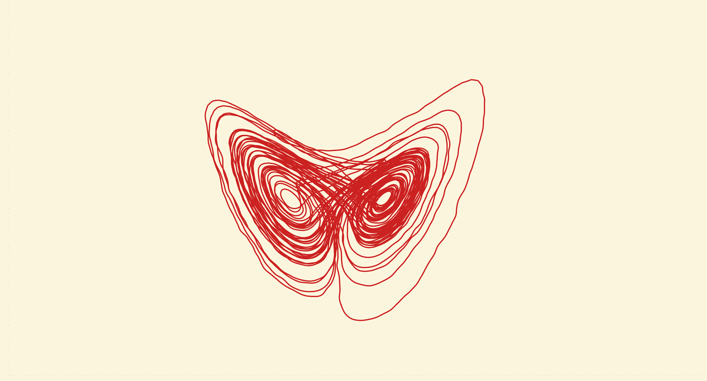
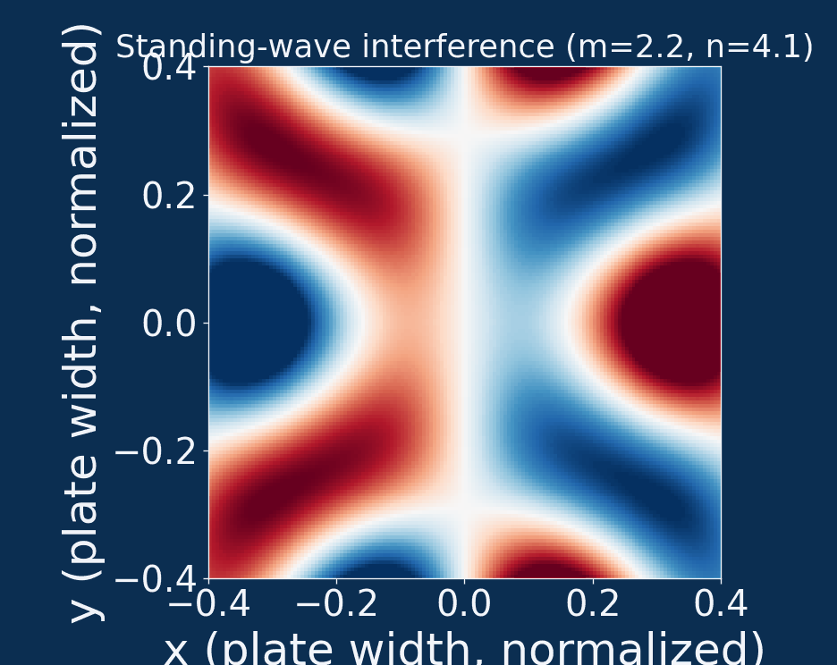
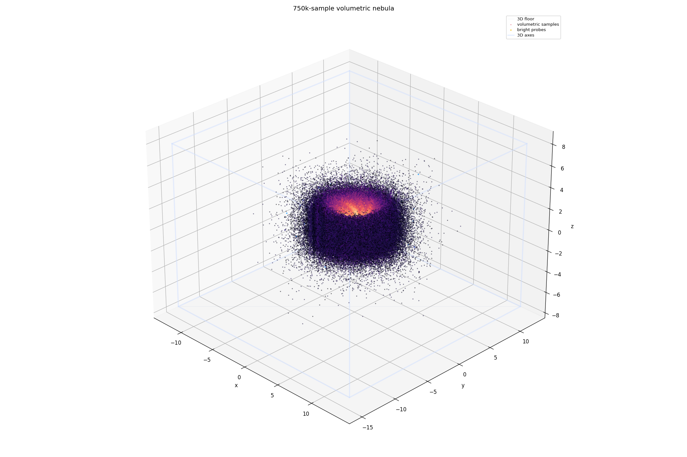

# GLPlot Examples

Everything here runs from the repository root, e.g. `python examples/ex_simple.py`.
Scripts open an interactive GLPlot window unless noted otherwise.

<table>
<tr>
<td align="center" width="33%">

 <b><a href="gallery/README.md">Static gallery</a></b>
 29 scripts: 2D, 3D, log scales, colorbars
</td>
<td align="center" width="33%">

 <b><a href="gallery/animations/README.md">Animated gallery</a></b>
 16 <code>FuncAnimation</code> scripts exported to GIF
</td>
<td align="center" width="33%">

 <b><a href="showcase/README.md">Showcase</a></b>
 4 short, interactive 2D/3D demos
</td>
</tr>
</table>

## Folders

| Folder | What's in it | Run |
| --- | --- | --- |
| [`gallery/`](gallery/README.md) | Numbered static examples, each rendered to `gallery/results/*.png`. | `python examples/gallery/run_gallery.py` |
| [`gallery/animations/`](gallery/animations/README.md) | Numbered animated examples, each exported to `gallery/animations/results/*.gif`. | `python examples/gallery/animations/run_animations.py` |
| [`showcase/`](showcase/README.md) | Short, interactive demos: particles, Mandelbrot, torus, sphere. | `python examples/showcase/01_colorful_particles_2d.py` |
| [`benchmark/`](benchmark/) | GLPlot compared with matplotlib, VisPy, fastplotlib, Datashader and hvPlot; plots go to `benchmark/results/`. | `python examples/benchmark/02_gpu_comparison.py` |
| [`free_energy_demo/`](free_energy_demo/) | The same 6-panel free-energy figure built twice, once in matplotlib and once in GLPlot, from shared data and composited with shared code. | `python examples/free_energy_demo/glplot_version.py` |

The benchmark scripts skip any library that isn't installed. For the full comparison, install
`vispy`, `fastplotlib`, `datashader`, `hvplot` and `psutil`.

## Standalone scripts

### Getting started

| Script | What it shows |
| --- | --- |
| [`ex_simple.py`](ex_simple.py) | Minimal `pyplot` loop: 10,000 offset sine curves with markers, kept responsive by adaptive level-of-detail (`set_lod`). |
| [`ex_scatter.py`](ex_scatter.py) | 5-million-point clustered scatter cloud. |
| [`ex_full_showcase.py`](ex_full_showcase.py) | A 200k-line flow field and a 10k-particle star layer in one figure. |
| [`ex_mpl_bridge.py`](ex_mpl_bridge.py) | Sending a GLPlot view to matplotlib: press `M` in the window, or call `to_matplotlib(ax=...)` and draw matplotlib artists on top. |

### Interactivity and live computation

| Script | What it shows |
| --- | --- |
| [`ex_interactive_controls.py`](ex_interactive_controls.py) | Native controls (`slider`, `checkbox`, `button`, `control_group`) driving a live signal-filtering bench with cursors and a results table. Needs `scipy`. |
| [`ex_function_plot.py`](ex_function_plot.py) | `function(f, xlim)`: curves resampled against the screen on every zoom, not stored. Flags: `--compare`, `--zoo`, `--poles`. |
| [`ex_mandelbrot.py`](ex_mandelbrot.py) | Escape-time Mandelbrot set. Flags: `--gpu` (GPU shader), `--zoom` (animated zoom). |

### Density rendering and performance

| Script | What it shows |
| --- | --- |
| [`ex_density.py`](ex_density.py) | 10 million `y = a·x + b` lines accumulated into a density image. |
| [`ex_density_gain.py`](ex_density_gain.py) | Setting the density brightness with `density_gain()`. |
| [`ex_read_density.py`](ex_read_density.py) | Reading the accumulated density buffer back into NumPy. |
| [`ex_expert_performance.py`](ex_expert_performance.py) | Stress test with 50 million lines (~400 MB of GPU memory). |
| [`ex_viewports.py`](ex_viewports.py) | 500,000 polylines (2.5M segments) through the instanced polyline renderer. |

### Internal checks

These scripts were written to check specific engine features by eye and are kept as
regression references.

| Script | What it checks |
| --- | --- |
| [`ex_v2_layers.py`](ex_v2_layers.py) | The low-level `GPULinePlot` layer API: a filled patch, outlined scatter, a thick polyline and text in one scene. |
| [`ex_aspect_ratio_fix.py`](ex_aspect_ratio_fix.py) | Aspect-ratio handling for data with extreme x/y ranges. |
| [`verify_polyline_cmap.py`](verify_polyline_cmap.py) | Colormapping on overlapping polylines. |

## Adding an example

- **Gallery / animations:** name the script `NN_short_name.py` so the runner picks it up in
  order, run the runner to write its image to `results/`, and add a line to that folder's
  README.
- **Standalone:** add a module docstring that says what the script shows and how to run it,
  then add a row to the right table above.
